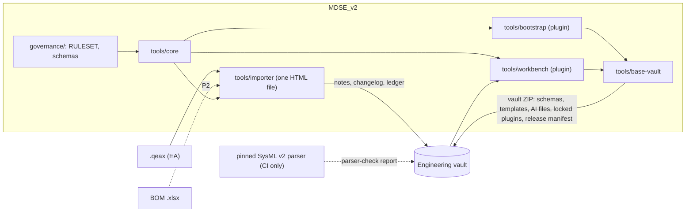

# Architecture

How the tools fit together, what each owns, and the contracts they share. Changing a boundary in this file needs a decision.

## Two trees

| Tree | What | Where |
|---|---|---|
| **Toolchain** | This repository: rules, schemas, tools, synthetic tests | GitHub `spencerskelly/MDSE_v2` (public, synthetic content only) |
| **Engineering vault** | The model engineers open in Obsidian, built by the tools | Private location (SharePoint first). Never in this repository |

## Data flow

## Tools

| Tool | Owns | Does not own |
|---|---|---|
| **core** (`tools/core`) | One implementation of the model contract: note parse/serialize, frontmatter order, UID/id rules, `## SysML v2` block read/replace, flag callouts, class table derived from `element-types.yaml` | Any UI; any I/O beyond strings and bytes |
| **importer** (`tools/importer`) | Reading `.qeax` (later BOM `.xlsx`), mapping by `ea-family-mapping.json`, identity allocation, writing notes into a new vault (ZIP) or onto an existing one (folder), source ledger, changelog, flags | Editing after import; plugin management; review decisions |
| **base-vault** (`tools/base-vault`) | Building the vault users receive: folder skeleton, templates, schemas and AI files, locked plugin payload, release manifest and hashes | Model content; model semantics |
| **bootstrap** (`tools/bootstrap`) | First-open and every-open checks: release integrity, activation of locked plugins, author registration and person note | Model content; engineering edits |
| **workbench** (`tools/workbench`) | Navigation, views, diagnostics, review UI; in P3, transactional edits that rewrite SysML text through core and the parser check | Model semantics; release packaging; Git |

All five are TypeScript (GOV-002) and release together under one release manifest (D-0002).

## Shared contracts

1. **RULESET.md** — the meaning of every rule.
2. **schemas/** — `element-types.yaml` (classes, prefixes, property order), `relationships.yaml` (MDSE-only relationships after OD-01), `authors.yaml`, `ea-family-mapping.json`.
3. **tools/core** — the only code that parses or writes a note. Other tools call it; none re-implement it.
4. **Note layout** — frontmatter; user zone (never rewritten by tools); `## Source: EA` (translated notes); `## SysML v2` as the last section with one fenced `sysml` block.
5. **Release manifest** — the only place exact versions and hashes appear (MOD-146).

## What ships into a vault

| Vault path | Comes from |
|---|---|
| `99_System/03_Schemas/` | `governance/schemas/` (`ea-family-mapping.json` excluded; importer-only) |
| `99_System/02_AI/` | `governance/ai/` |
| `99_System/05_Templates/` | `tools/base-vault/` (to build) |
| `99_System/22_Views/` | `tools/base-vault/` (README only). Temporary Workbench views; Git-ignored; never model content (D-0023) |
| `99_System/23_Saved_Views/` | `tools/base-vault/` (README only). Canvases the user saved; committed; never model content (D-0023) |
| `.gitignore` | `tools/base-vault/`. Files that stay local: Obsidian workspace and per-user settings, plugin `data.json`, temporary views |
| `.obsidian/` plugins and lock | `tools/base-vault/`, `tools/bootstrap/`, `tools/workbench/` builds. Today only the Workbench is bundled (`plugin-lock.yaml` status PARTIAL). An existing vault is brought up to date by the importer's vault-update step (D-0024) |

Methodology material (this repository's governance beyond the files above) never ships into a vault.

## Identity

- Note identity is the UID, never path or filename.
- Source identity (EA GUID, BOM PN and row) is provenance, kept in `## Source: EA` and the import ledger.
- Identity for usages inside SysML text: open (OD-03).

## Non-goals for Phase 1

EA diagrams, cross-vault links, multi-user concurrent editing, automatic plugin updates, enterprise login.
